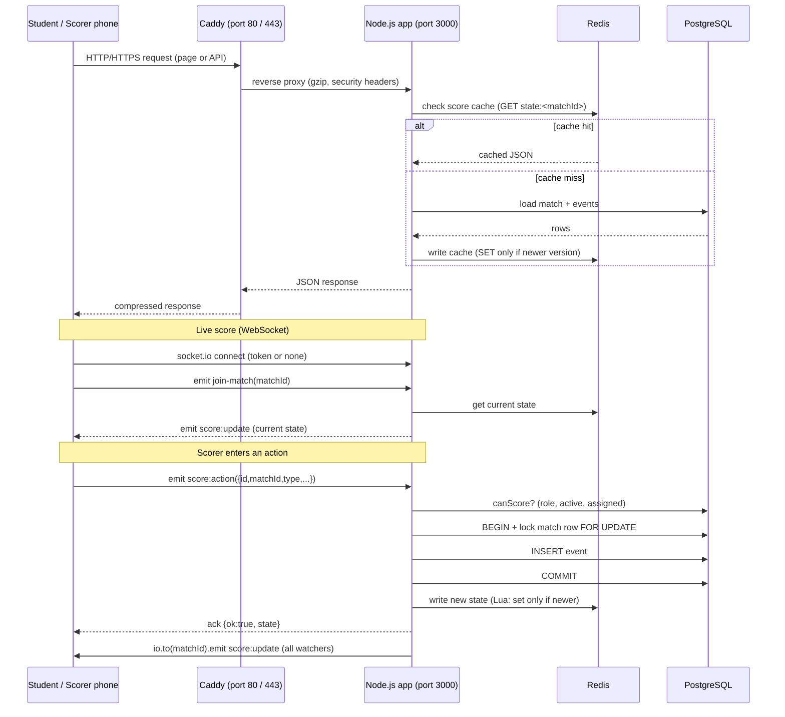
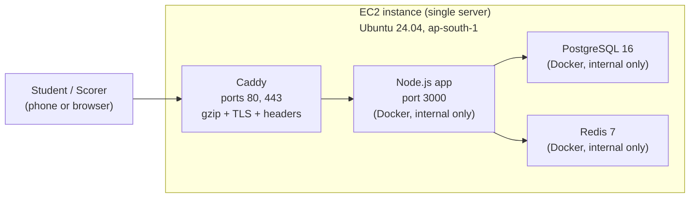

# Architecture — College Live Score

---

## 1. Request-flow diagram



---

## 2. Deployment diagram



Only Caddy has `ports:` in `docker-compose.yml`. PostgreSQL and Redis are not reachable from outside the Docker network.

---

## 3. Score-action flow (detailed)

When a scorer taps a button, the scorer page:

1. Generates a unique action `id` (UUID).
2. Emits `score:action` over the existing Socket.IO connection with an ack callback.
3. If the ack does not arrive in time, the action is retried with the **same id**.

On the server (`server.js → applyAction`):

| Step | What happens |
|---|---|
| 1 | Check input shape (type, matchId, id are strings; data is a small object or null) |
| 2 | `canScore`: query the DB for the user's role, active flag, and match assignment |
| 3 | `BEGIN` a transaction; lock the match row with `FOR UPDATE` |
| 4 | Load all events for the match from the DB |
| 5 | Duplicate check: if `id` already exists in `events`, return `ok:true` without re-applying |
| 6 | For `undo`: check there is something to undo. For everything else: `engine.validate()` |
| 7 | `INSERT` the new event row |
| 8 | `COMMIT` |
| 9 | Write the new state to Redis (Lua script: only if `state.version` is higher than what is there) |
| 10 | `io.to(matchId).emit("score:update", state)` — delivered to every watcher on every server via the Redis adapter |
| 11 | `ack({ ok: true, state })` back to the scorer |

The idempotent `id` means a scorer can tap again on a network blip and the score will not be doubled.

---

## 4. Data model

### Tables

| Table | Purpose |
|---|---|
| `users` | username (PK), bcrypt password hash, role (`admin` or `scorer`), active flag |
| `matches` | id (PK, text slug), name, sport, `best_of`, `config` (JSONB for cricket settings), `team_a`, `team_b`, `competition`, `stage` (`group` or `knockout`), `venue`, `start_time`, `created_at` |
| `match_scorers` | (username, match_id) composite PK — which scorer is assigned to which match |
| `events` | seq (bigserial PK), id (unique action id from client), match_id, type (`point`, `undo`, `finish`, `ball`, `end_innings`), team (`A` or `B`), value (integer, points), data (JSONB — cricket ball details), `by_user`, `created_at` |
| `schema_migrations` | name (PK), applied_at — tracks which migration files have run |

### Event log and undo

The `events` table is **append-only**. No row is ever updated or deleted.

An `undo` event does not delete anything. `effectivePoints(events)` replays the log: each `undo` pops the most recent non-undo event off a stack. The result is the list of events that actually count. The engine's `compute` function receives this filtered list.

This means:
- The full history is always available (the `by_user` column records who entered each action).
- Undo is always safe — it can be undone itself.
- Replaying a match from scratch is always possible (useful for debugging).

---

## 5. Caching (Redis)

| Cache | Key / mechanism | TTL | Purpose |
|---|---|---|---|
| Score state | `state:<matchId>` | 60 s | Avoids a DB query for every student who joins a match. If Redis is down, the server falls back to the DB. |
| Home page data | In-process JS object + compressed packet | 3 s | A single rebuild serves thousands of students. Rebuilt on any match change or after 3 s. |
| Match metadata | In-process JS `Map` | 10 s | Cache for `/api/match/:id`. |
| Match list | In-process JS object | 10 s | Cache for `/api/matches` (legacy endpoint). |

**"Set only if newer" (Lua script):** when two servers race to write a state, the one with the lower `version` number loses. This keeps the cache consistent without a lock.

**Redis down:** `disableOfflineQueue: true` on the cache client means failed Redis calls fail immediately. The server catches the error, logs it, and falls back to the database. Scoring never stops because of Redis.

**Redis adapter (Socket.IO):** `pubClient` and `subClient` let `io.to(matchId).emit(...)` reach students connected to any server. This would allow horizontal scaling in future.

### When the database or Redis fails

| Situation | What happens |
|---|---|
| Server boots, containers start together | `docker-compose.yml` health checks: the app starts only after `db` answers `pg_isready` and `redis` answers `PING`. |
| Redis not reachable when the app starts | The app exits (`server.js` `main()`), Docker restarts it. The health check makes this rare. |
| Postgres restarts while the app runs | Idle pool connections break; `db.js` logs `db pool error ...` and the pool opens new ones. Before 2026-11-11 this crashed the whole app (tested). |
| Postgres down or hung | Each query fails after at most 5 s (`connectionTimeoutMillis`). HTTP routes answer 500; scorer actions get `{ ok:false, retry:true }`, so the phone keeps the entry and retries. Students keep the last score: Redis copy up to 60 s, home page cache 3 s. |
| Postgres back | Next query works; nothing to restart. |

Health checks only order the START. Docker does not restart a container because it is "unhealthy"; `restart: unless-stopped` restarts only a container that exited.

---

## 6. Live updates (Socket.IO)

- One **room per match** (the match id is the room name).
- Students join by emitting `join-match`. The server immediately sends the current state so the page is never blank.
- Scorers send `score:action` and receive an ack.
- After every accepted action, the server broadcasts `score:update` to the room.
- The student page stores `state.version` and ignores updates with an older version.
- **Join limit:** one connection may emit `join-match` at most 30 times in 10 seconds (guards against loops).
- **Message size limit:** 10 KB per Socket.IO message; 20 KB per JSON HTTP body.

---

## 7. Auth and roles

| Role | How they connect | What they can do |
|---|---|---|
| Student | No token (anonymous socket) | Watch live matches, read home/standings |
| Scorer | JWT (12 h) from `POST /login` | Score events on assigned matches |
| Admin | JWT (12 h) from `POST /login` | Score any match; manage matches and scorers via `/api/admin/*` |

The JWT contains only `username`. Every sensitive operation (scoring, admin API) re-checks the database: role, `active` flag, and match assignment. Setting `users.active = false` cuts off a lost phone immediately.

The admin API (`/api/admin/*`) checks the JWT on every request and re-reads the database. It is not cached.

---

## 8. Rate limits and protections

| Protection | Where | Detail |
|---|---|---|
| Login failures per username | `rateLimit.js` + `server.js` | 5 wrong passwords for one username from one IP in 10 min → that IP is blocked for up to 10 min |
| Login failures per address | `rateLimit.js` + `server.js` | 40 wrong attempts from one IP in 10 min → blocked |
| Join rate per socket | `server.js` | 30 joins per 10 s per connection |
| Socket message size | `socket.io` options | 10 KB maximum |
| JSON body size | Express `json()` middleware | 20 KB maximum |
| Security headers | `Caddyfile` | `X-Content-Type-Options: nosniff`, `X-Frame-Options: DENY`, `Referrer-Policy: no-referrer`, `Strict-Transport-Security` |
| Framework name hidden | `app.disable("x-powered-by")` | Hides `X-Powered-By: Express` |
| Ports not exposed | `docker-compose.yml` | Only Caddy has `ports:` |

**Known gaps:**
- Login rate-limit counters live in memory. Restarting the app clears them. Two servers would not share them (move to Redis if scaling).
- Students on the same college Wi-Fi share one public IP. Forty failed logins from that IP blocks everyone there for 10 minutes (acceptable trade-off for a college event).
- No Content-Security-Policy header yet (needs careful testing on real phones before it is safe to add).
- Admin panel and scorer page are served over HTTP if `DOMAIN` is not set. Passwords travel in the clear. Set `DOMAIN` in `.env` before the event.

---

## 9. What limits capacity

**The bottleneck is memory, not CPU.**

Caddy holds an encrypted connection (TLS) for every live WebSocket viewer. This costs about **133 KB per live watcher** in Caddy and about 9 KB in Node.

Measured numbers (real software, test machine):

| What | Measured |
|---|---|
| Memory per live watcher (WebSocket) | Caddy ~133 KB, Node ~9 KB |
| Memory per browsing-only student | Caddy ~45 KB, Node ~0 |
| Home-page answer on the wire (compressed) | ~2.2 KB |
| CPU per home-page refresh | ~1 ms |
| CPU per score broadcast to one watcher | ~40 µs |

Rough memory formula:

```
used (MB) = fixed + 0.045 × browsing_students + 0.149 × live_watchers
fixed ≈ 730  (Node 124 + Caddy 47 + Postgres 150 + Redis 10 + OS/Docker 400)
```

Replace `fixed` with the real idle-server number from `free -m`.

**Load test results on the owner's server** (AWS ap-south-1):

| Students | Server | Result |
|---|---|---|
| 500 | 2 GiB | PASS |
| 1,000 | 2 GiB | PASS |
| 2,000 | 2 GiB | PASS |
| 5,000 | 4 GiB | Looks healthy (CPU 17–33%, ~1.66 GB memory used) — not an official PASS yet |
| 10,000 | any | Untested |

> **Important:** the real bottleneck formula under-estimated Caddy's memory in early tests. The measured number at 5,000 students was about 2× higher than the formula predicted. Always run `./scripts/watch-load.sh` during a test and trust the live numbers over the formula.

**Load-test tools in this repo:**
- `loadtest-real.js` — realistic simulator (run on a separate load machine, not on the server).
- `loadtest-real-fixed.js` — same as above, with a 3-second grace period after joining so the server's "current score" message is not counted as a slow delivery. This is the preferred version.
- `scripts/watch-load.sh` — prints CPU, memory, swap, and container stats every few seconds.

---

## 10. Security model

**What is protected and how:**

| Asset | Protection |
|---|---|
| Passwords | bcrypt-hashed in the database; never stored or logged in plain text |
| JWT secret | In `.env` only; never in Git; used to sign 12-hour tokens |
| DB password | In `.env` only; never in Git |
| Score data | Append-only event log; undo is an event too — nothing is ever deleted |
| Admin API | JWT on every request + DB role check |
| Score actions | DB check: role, active, and match assignment on every action |
| User text | Rendered with `textContent`, never `innerHTML` |
| Database and Redis ports | Not exposed outside Docker network |

**Known gaps (not yet fixed):**
- HTTP only by default (set `DOMAIN` in `.env` to enable HTTPS via Caddy + Let's Encrypt).
- Login rate-limit counters are in memory — a restart clears them.
- No Content-Security-Policy header.
- Admin accounts can only be created with `add-user.js` from the command line; there is no admin UI for managing admin accounts.
- No two-step login.
- Backups are on the same server — if the server is lost, so are the backups unless they were copied off.

